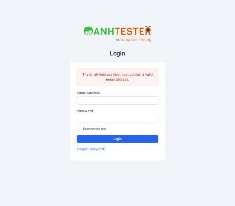
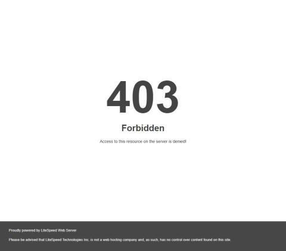
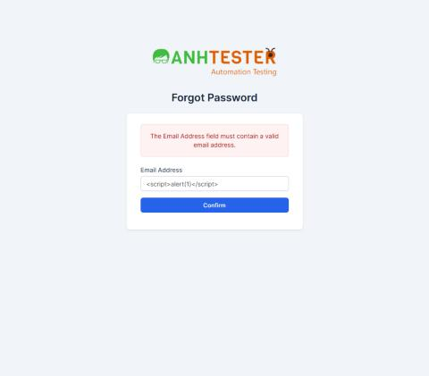
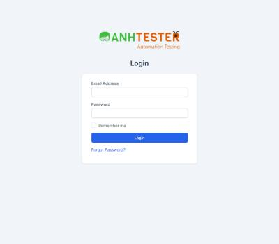
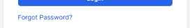

# Execution Report — Đăng nhập (`LOGIN`) · Web · Chạy theo phạm vi chọn (34 TC)

| Thông tin | Nội dung |
|---|---|
| Run ID | run_1794303621 |
| Nền tảng | `web` |
| Loại nguồn | `Bộ TC` |
| Nguồn TC | [`part_01_web_chuc_nang.md`](../../../../testcases/login/web/test_cases_login_web.md) · [`part_02_web_ky_thuat_phi_chuc_nang.md`](../../../../testcases/login/web/test_cases_login_web.md) — bản sau `/review-testcases` FIX 10-11-2026 (58 TC) |
| Phạm vi | 34/58 TC · loại 0 TC `@Deprecated`. **26 TC không cần đăng nhập:** 001, 002, 004, 008–014, 016, 017, 020–025, 028, 037, 046–048, 050, 052, 056 · **8 TC cần sẵn phiên admin (user tự đăng nhập):** 003, 007, 030–033, 049, 055. **24 TC ngoài phạm vi lần chạy** (bước phải gõ mật khẩu admin / tài khoản test — agent không nhập mật khẩu thật trên host không phải môi trường test): 005, 006, 015, 018, 019, 026, 027, 029, 034, 035, 036, 038–045, 051, 053, 054, 057, 058 |
| Môi trường | `https://crm.anhtester.com` (biến `URL` trong `.env`) — môi trường demo dùng chung |
| Build / Version | Perfex CRM 3.1.6 (theo requirements) |
| Tài khoản | Không đăng nhập ở nhóm 26 TC · nhóm 8 TC dùng tài khoản admin `.env`, **do user tự đăng nhập** trong khung trình duyệt |
| Trình duyệt | Trình duyệt tích hợp của Claude desktop app (Chromium) — Playwright MCP chưa được đăng ký trong phiên |
| Người thực hiện | minhai2204-debug (agent hỗ trợ) |
| Bắt đầu → Kết thúc | 10-11-2026 16:40 → 17:00 (≈ 20 phút chạy, chưa tính thời gian chờ user đăng nhập) |
| Cách nhập liệu | TC kiểm phản hồi máy chủ: đặt giá trị ô bằng script rồi **bấm nút thật** (`click()` kích hoạt kiểm tra của trình duyệt như người dùng). TC kiểm cách gõ / bàn phím / chuột (013-d, 013-f, 016, 020, 024-e, 037, 050, 052, 055, 003, 007, 033, 049): thao tác thật. Biến thể có tên miền Unicode phải gõ tay — Chrome chỉ đổi sang punycode khi người dùng gõ |
| Môi trường dùng chung? | Có — auto-skip TC phá huỷ đang BẬT |
| Video | Không — chưa nạp tool quay (Playwright MCP chưa đăng ký ở `.mcp.json` gốc project; trình duyệt tích hợp không quay được video) |
| Thứ tự chạy | 26 TC không đăng nhập trước (trình duyệt chưa có phiên), sau đó 8 TC cần phiên: 003 → 055 → 030 → 031 → 049 → 007 → 032 → 033 |

## 1. Tổng kết

| Trạng thái | Số lượng | Tỷ lệ |
|---|---|---|
| ✅ PASS | 25 | 73.5% |
| ❌ FAIL | 6 | 17.6% |
| ⚠️ BLOCKED | 3 | 8.8% |
| ⏭️ SKIPPED | 0 | 0% |
| **Tổng** | **34** | 100% |

> **Pass rate (không tính SKIPPED):** 25/34 = 73.5% · 24 TC còn lại của bộ (58) **ngoài phạm vi lần chạy**, không tính vào bảng.
>
> **Đọc kết quả FAIL:** chỉ **1 lỗi hệ thống thật** — thiếu viền focus ở logo và `Forgot Password?` (FAIL #5, #6). 4 FAIL còn lại (#1–#4) đều do **giả định trong TC lệch thực tế**: máy chủ có kiểm định dạng / độ dài email riêng, và tường lửa máy chủ web trả 403 cho chuỗi `<img … onerror=`. Hệ thống ở các chỗ đó hành xử an toàn.

## 2. Kết quả từng TC

| TC ID | Test Scenario | Kết quả | Bước fail | Ghi chú |
|---|---|---|---|---|
| CRM_LOGIN_TC_001 | Trang Login hiển thị đủ thành phần, đúng nhãn, thứ tự, trạng thái mặc định | ⚠️ BLOCKED | — | Viewport 1600×800. Mục `1`, `2`, `3`, `5`, `6` đạt (tiêu đề tab `Perfex CRM \| Anh Tester Demo - Login`; không captcha, không link đăng ký, không nút hiện/ẩn). Mục `4`: ô Email đang giữ focus sẵn (đạt), nhưng **viền xanh không quan sát được** vì khung trình duyệt không giữ focus của hệ điều hành (`document.hasFocus() = false`) → BLOCKED một ý. 🔧 logo `alt` = `Perfex CRM \| Anh Tester Demo` |
| CRM_LOGIN_TC_002 | Trang Forgot Password hiển thị đủ thành phần, đúng nhãn, trạng thái mặc định | ✅ PASS | — | Logo + tiêu đề `Forgot Password`; `Email Address` + nút xanh `Confirm`; ô trống, focus ở `BODY` (không ở ô Email); phần tử bấm được ngoài form chỉ có logo; tab `… - Login` |
| CRM_LOGIN_TC_004 | Mở trang Forgot Password bằng mọi lối vào | ✅ PASS | — | `a` liên kết · `b` gõ URL — cả hai tới `/admin/authentication/forgot_password`, tiêu đề `Forgot Password`, không khung lỗi |
| CRM_LOGIN_TC_008 | Bỏ trống cả Email và Password → 2 thông báo bắt buộc | ✅ PASS | — | 2 khung: `The Password field is required.` · `The Email Address field is required.`; hai ô trống; focus ô Email |
| CRM_LOGIN_TC_009 | Có Email, Password trống / toàn khoảng trắng → chỉ thông báo Password | ✅ PASS | — | `a`, `b`, `c` đều đúng một khung `The Password field is required.`, không có `Invalid email or password` |
| CRM_LOGIN_TC_010 | Email trống / toàn khoảng trắng, có Password → chỉ thông báo Email | ✅ PASS | — | `a`, `b`: đúng một khung `The Email Address field is required.`; ô Password trống sau khi nạp lại. Đề nghị gỡ `@assumption-based` cho AMB-LOGIN-17 |
| CRM_LOGIN_TC_011 | Email thiếu thành phần bắt buộc → trình duyệt chặn | ✅ PASS | — | `a`–`d`: sự kiện `invalid` của trình duyệt bắn ra, `typeMismatch = true`, con trỏ nhảy về ô Email, trang **không** nạp lại, không khung đỏ, chữ hai ô còn nguyên. Bong bóng cảnh báo là popup gốc của trình duyệt — ảnh chụp khung không bắt được, chấm theo các dấu hiệu trên. 🔧 không có request gửi form (trang không rời) |
| CRM_LOGIN_TC_012 | Email sai cấu trúc / ký tự không hợp lệ → trình duyệt chặn | ✅ PASS | — | `a`–`f` (gồm `f` mới thêm `qa(login)@…`) đều bị chặn như TC_011 |
| CRM_LOGIN_TC_013 | Email đúng định dạng nhưng không tồn tại → "Invalid email or password" | ❌ FAIL | 5 · biến thể `d` | `a`, `b`, `c`, `e`, `f` đạt. `d` (`qa.login@localhost`): máy chủ trả `The Email Address field must contain a valid email address.` — xem FAIL #1. Biến thể `f` phải **gõ tay** (Chrome đổi tên miền sang punycode `xn--tingvit-5t4cyc`); đặt giá trị bằng script thì trình duyệt chặn — không phải lỗi hệ thống |
| CRM_LOGIN_TC_014 | Email rất dài → vẫn gửi được, hệ thống không lỗi | ❌ FAIL | 5 · biến thể `b`, `c` | `a` (254 ký tự) đạt: ô nhận đủ chuỗi, đuôi `.invalid`, khung `Invalid email or password`. `b` (255) và `c` (320): máy chủ trả `The Email Address field must contain a valid email address.` — không lỗi hệ thống, nhưng khác Expected. Xem FAIL #2 |
| CRM_LOGIN_TC_016 | Ô Password che ký tự, không sao chép được ra ngoài | ⚠️ BLOCKED | — | Bước 3 đạt: 9 dấu chấm, ô `type=password`. Bước 5 **không kiểm được**: tổ hợp phím Ctrl+C / Ctrl+V do công cụ gửi không chạm bộ nhớ tạm của hệ điều hành — bước dựng tiền đề (chép `ClipboardCu`) đã dán ra chuỗi rỗng |
| CRM_LOGIN_TC_017 | Password độ dài cực trị, có dấu, emoji, khoảng trắng → thông báo chung | ✅ PASS | — | `a`–`f` (1 · 72 · 1024 ký tự · có dấu · emoji · khoảng trắng đầu/cuối) đều một khung `Invalid email or password`, không chữ kỹ thuật |
| CRM_LOGIN_TC_020 | Tích / bỏ tích Remember me bằng ô vuông và bằng nhãn chữ | ✅ PASS | — | Bước 1–5 đúng (bấm chuột thật). Bước 4–5 `@NeedsVerify`: **đã xác nhận trên UI** — nhãn gắn với ô (`label for=remember`) — đề nghị gỡ `@NeedsVerify` |
| CRM_LOGIN_TC_021 | Ô Email bị xoá trống sau khi máy chủ báo lỗi | ✅ PASS | — | `a`: khung `The Password field is required.`; ô Email trống, ô Password trống, focus ô Email |
| CRM_LOGIN_TC_022 | Forgot bỏ trống / toàn khoảng trắng → "Email not found" | ✅ PASS | — | `a`, `b`: vẫn ở trang Forgot, đúng một khung `Email not found` (hành vi hiện tại — AMB-LOGIN-05, nghi lỗi nghiệp vụ) |
| CRM_LOGIN_TC_023 | Forgot email sai định dạng → trình duyệt chặn | ✅ PASS | — | `a`–`f`: sự kiện `invalid` bắn ra, `typeMismatch = true`, không nạp lại, không khung `Email not found`, chữ còn nguyên. Bong bóng là popup gốc — không chụp được |
| CRM_LOGIN_TC_024 | Forgot email đúng định dạng nhưng không tồn tại → "Email not found" | ✅ PASS | — | `a`–`e` một khung `Email not found`, không chữ kỹ thuật. `d` 254 ký tự đạt (khác Login: Forgot không trả lỗi định dạng). `e` gõ tay → punycode `xn--tingvit-5t4cyc` |
| CRM_LOGIN_TC_025 | Forgot giữ nguyên Email sau lỗi, gửi lại không cần gõ lại | ✅ PASS | — | Ô Email giữ `recon.khongtontai@example.invalid` sau lần 1 và lần 2; lần 2 vẫn chỉ một khung `Email not found` |
| CRM_LOGIN_TC_037 | Bấm đúp nút Confirm → một thông báo, không trang lỗi | ✅ PASS | — | Bấm đúp thật: vẫn ở trang Forgot, một khung `Email not found`, ô Email giữ chữ, không trang từ chối |
| CRM_LOGIN_TC_028 | Chưa đăng nhập mở thẳng route admin → về trang Login, không thông báo | ✅ PASS | — | `a` `/admin/` · `b` `/admin/clients` · `c` `/admin/invoices` · `d` `/admin/projects` đều dừng ở `/admin/authentication`, không khung thông báo, không thanh bên |
| CRM_LOGIN_TC_046 | Chuỗi tiêm SQL qua được kiểm tra định dạng ở ô Email vẫn không đăng nhập được | ✅ PASS | — | `a`–`c`: trình duyệt không chặn, một khung `Invalid email or password`, không vào Dashboard, không chữ kỹ thuật |
| CRM_LOGIN_TC_047 | SQLi / script ở ô Password không vượt qua đăng nhập, không chạy script | ❌ FAIL | 4–5 · biến thể `e` | `a`–`d` đạt (không hộp `alert`, một khung `Invalid email or password`). `e` (`">`): máy chủ web trả trang **403 Forbidden** (LiteSpeed) thay vì trang Login — xem FAIL #3. Không có script nào chạy |
| CRM_LOGIN_TC_048 | Giá trị Email hiện lại ở trang Forgot không chạy được script | ❌ FAIL | 5 · biến thể `a`, `b` | `c` đạt (`Email not found`, ô giữ nguyên chuỗi). `a`: không chạy script, ô hiện lại **nguyên chuỗi chữ** `` (đạt ý chống XSS) nhưng khung đỏ là `The Email Address field must contain a valid email address.` thay vì `Email not found`. `b`: trang **403 Forbidden** — xem FAIL #4. 🔧 bước 2 làm bằng đổi `type` của ô qua script |
| CRM_LOGIN_TC_050 | Thứ tự phím Tab trên trang Login hợp lý, viền focus nhìn thấy được | ❌ FAIL | 2, 7 | Thứ tự đúng: logo → `Email Address` → `Password` → `Remember me` → `Login` → `Forgot Password?`. Viền focus thấy rõ ở bước 3–6; **bước 2 (logo) và bước 7 (`Forgot Password?`) không có viền focus** (`outline-style: none`, không box-shadow, không gạch chân) — xem FAIL #5. 🔧 logo `alt` = `Perfex CRM \| Anh Tester Demo` — không rỗng, đạt |
| CRM_LOGIN_TC_052 | Trang Forgot Password dùng được hoàn toàn bằng bàn phím | ❌ FAIL | 2 | Bước 1, 3, 4, 5 đạt (focus không sẵn trong ô; Tab thứ 2 vào ô Email; Enter gửi form → `Email not found`, ô giữ chữ). Bước 2 `@NeedsVerify`: focus **có** lên logo (thứ tự Tab đúng ASM-14) nhưng **không có viền focus** — xem FAIL #6. 🔧 `alt` logo không rỗng, đạt |
| CRM_LOGIN_TC_003 | Menu ảnh đại diện có mục Logout, chỉ hiện sau khi mở menu | ✅ PASS | — | Trước khi mở: không thấy chữ `Logout`. Mở menu: đúng 5 mục `My Profile` · `My Timesheets` · `Edit Profile` · `Language ›` · `Logout` |
| CRM_LOGIN_TC_055 | Menu ảnh đại diện đóng khi bấm ra ngoài, bấm lại ảnh đại diện, bấm Esc | ✅ PASS | — | `a`, `b`, `c` đều đóng menu, vẫn ở `/admin/`. `@NeedsVerify` **đã xác nhận trên UI** — đề nghị gỡ tag |
| CRM_LOGIN_TC_030 | Đã đăng nhập mở lại trang Login → về Dashboard | ✅ PASS | — | `a` tab đang mở · `b` tab mới: đều dừng ở `/admin/`, tab `Dashboard`, không form Login |
| CRM_LOGIN_TC_031 | Đã đăng nhập mở trang Forgot Password → về Dashboard | ✅ PASS | — | `a`, `b`: dừng ở `/admin/`, không form Forgot |
| CRM_LOGIN_TC_049 | Bấm Back sau khi đăng xuất không xem tiếp / thao tác được dữ liệu | ✅ PASS | — | Tiền đề: danh sách Customers có 25 dòng (không cần tạo dữ liệu). Logout → trang Login; Back → bị đưa ngay về trang Login (không hiện ảnh cũ) — bước 4 không có danh sách để bấm; dừng ở `/admin/authentication` |
| CRM_LOGIN_TC_007 | Đăng xuất từ menu ảnh đại diện → về trang Login ngay, không hỏi xác nhận | ✅ PASS | — | `Logout` là mục cuối menu; không hộp thoại xác nhận; về `/admin/authentication`, form đủ `Email Address` · `Password` · `Remember me` · `Login`, ô Email trống, focus ô Email, không khung đỏ |
| CRM_LOGIN_TC_032 | Sau Logout mở route admin → bắt đăng nhập lại | ✅ PASS | — | Chạy nối tiếp sau TC_007 (đúng Pre-Condition). `a` `/admin/` · `b` `/admin/clients` đều dừng ở `/admin/authentication`, form Login hiện |
| CRM_LOGIN_TC_033 | Đăng xuất ở tab A, tab B đang mở trang admin thao tác tiếp → bị đưa về Login | ✅ PASS | — | Tab A Dashboard, tab B `/admin/clients` (cùng cửa sổ). Logout ở tab A → trang Login; tab B bấm `Projects` → dừng ở `/admin/authentication`, không mở được Projects. Trước TC này user đăng nhập lại — trang đích `/admin/` |
| CRM_LOGIN_TC_056 | F5 sau khi đăng nhập sai, đồng ý gửi lại biểu mẫu → vẫn ở trang Login | ⚠️ BLOCKED | — | Bước 4 đạt (`Invalid email or password`). Bước 5–7 không thực hiện được: phím F5 do công cụ gửi chỉ tới trang, **không** tới khung trình duyệt — trang không nạp lại, không có hộp thoại gửi lại biểu mẫu để bấm |

## 3. Chi tiết TC FAIL

### FAIL #1 — CRM_LOGIN_TC_013 · Email đúng định dạng nhưng không tồn tại → thông báo chung

| | |
|---|---|
| REQ ID | REQ-LOGIN-07 |
| Priority | High |
| Bước fail | Bước 5 · biến thể `CRM_LOGIN_TC_013-d` (`qa.login@localhost` / `Abc@12345`) — biến thể `a`, `b`, `c`, `e`, `f` PASS |
| **Expected** | Trình duyệt không chặn; trang nạp lại; **đúng một** khung đỏ `Invalid email or password`; hai ô trống |
| **Actual** | Trình duyệt không chặn, trang nạp lại, hai ô trống — nhưng khung đỏ là `The Email Address field must contain a valid email address.` (máy chủ có kiểm định dạng email riêng, chặt hơn trình duyệt: email không có dấu chấm ở tên miền bị máy chủ từ chối) |
| Evidence |  |
| Tái hiện được? | Có — 2 lần (nhập bằng script và gõ tay) đều cùng kết quả |
| Nhận định | Nhiều khả năng **TC viết theo giả định sai** (ASM-03 chỉ nói về trình duyệt, không nói máy chủ có kiểm định dạng riêng) — hành vi máy chủ hợp lý, không lộ thông tin. Đối chiếu lại TC / requirements trước khi báo bug |

### FAIL #2 — CRM_LOGIN_TC_014 · Email rất dài → vẫn gửi được, hệ thống không lỗi

| | |
|---|---|
| REQ ID | REQ-LOGIN-07 |
| Priority | Medium |
| Bước fail | Bước 5 · biến thể `CRM_LOGIN_TC_014-b` (255 ký tự), `CRM_LOGIN_TC_014-c` (320 ký tự) — biến thể `a` (254) PASS |
| **Expected** | Trình duyệt không chặn; trang nạp lại về Login; đúng một khung `Invalid email or password`; không trang lỗi hệ thống |
| **Actual** | Trình duyệt không chặn, trang nạp lại, không lỗi hệ thống — nhưng khung đỏ là `The Email Address field must contain a valid email address.` |
| Evidence |  |
| Tái hiện được? | Có — ranh giới đúng 254/255 ký tự |
| Nhận định | Máy chủ giới hạn email ≤ 254 ký tự (đúng chuẩn RFC). Cùng gốc với FAIL #1: ASM-05 giả định máy chủ không kiểm định dạng / độ dài. Hành vi an toàn — đối chiếu lại TC trước khi báo bug |

### FAIL #3 — CRM_LOGIN_TC_047 · SQLi / script ở ô Password

| | |
|---|---|
| REQ ID | REQ-LOGIN-07 |
| Priority | High |
| Bước fail | Bước 4–5 · biến thể `CRM_LOGIN_TC_047-e` (Password `">`) — biến thể `a`–`d` PASS |
| **Expected** | Không hộp `alert`; trang nạp lại về trang Login; một khung `Invalid email or password`; không trang lỗi |
| **Actual** | Không hộp `alert` (đạt), nhưng trang trả về là **403 Forbidden — "Access to this resource on the server is denied!" — Proudly powered by LiteSpeed Web Server**, không phải trang Login. Mở lại `/admin/authentication` ngay sau đó vẫn vào được bình thường |
| Evidence |  |
| Tái hiện được? | Chạy 1 lần (không lặp lại để tránh bị tường lửa chặn IP trên môi trường dùng chung). Cùng hiện tượng ở TC_048-b với chuỗi tương tự → nhiều khả năng do bộ lọc của máy chủ web (WAF), không phải ứng dụng |
| Nhận định | Hệ thống **an toàn** (request bị chặn trước ứng dụng), nhưng người dùng gõ mật khẩu chứa `alert(1)</script>`): không `alert`, ô Email hiện lại **nguyên chuỗi chữ** (đạt ý chống XSS), nhưng khung đỏ là `The Email Address field must contain a valid email address.` — máy chủ kiểm định dạng trước khi tra email. `b` (`">`): trang **403 Forbidden** của LiteSpeed |
| Evidence |  |
| Tái hiện được? | `a`: có — 2 lần. `b`: 1 lần (như FAIL #3) |
| Nhận định | Ý chính của TC (không chạy script, hiện lại dạng chữ) **đạt** ở `a`. Phần lệch là Expected giả định máy chủ không kiểm định dạng (ASM-19) — cùng gốc FAIL #1, #2; và phản hồi WAF (cùng gốc FAIL #3). Đối chiếu lại TC trước khi báo bug |

### FAIL #5 — CRM_LOGIN_TC_050 · Thứ tự Tab và viền focus trang Login

| | |
|---|---|
| REQ ID | REQ-LOGIN-02, REQ-LOGIN-01 |
| Priority | Medium |
| Bước fail | Bước 2 (logo) · bước 7 (liên kết `Forgot Password?`) |
| **Expected** | Ở mỗi bước 2–7 đều thấy rõ viền focus quanh phần tử đang được chọn |
| **Actual** | Thứ tự Tab đúng. Ô `Email Address`, `Password`, `Remember me`, nút `Login` có viền focus rõ. Logo và liên kết `Forgot Password?` **nhận focus nhưng không hiện gì**: style tính được `outline-style: none`, `box-shadow: none`, liên kết không gạch chân — người dùng bàn phím không biết đang đứng ở đâu |
| Evidence | Logo đang focus, không viền:  · `Forgot Password?` đang focus, không viền:  · đối chứng nút `Login` có viền:  |
| Tái hiện được? | Có — đo lại bằng `focus()` trực tiếp: logo vẫn `outline-style: none` |
| Nhận định | Lỗi hệ thống thật (WCAG 2.4.7 Focus Visible). Ứng viên cho `/create-bug-report` |

### FAIL #6 — CRM_LOGIN_TC_052 · Trang Forgot Password dùng bằng bàn phím

| | |
|---|---|
| REQ ID | REQ-LOGIN-18 |
| Priority | Medium |
| Bước fail | Bước 2 |
| **Expected** | Viền focus lên logo — ⚠️ chưa có evidence (`@NeedsVerify`) |
| **Actual** | Focus **có** chuyển lên logo (thứ tự đúng ASM-14) nhưng không hiện viền: `outline-style: none`, `box-shadow: none` — cùng gốc FAIL #5 |
| Evidence | Như FAIL #5 (cùng phần tử logo, cùng CSS) |
| Tái hiện được? | Có |
| Nhận định | TC `@NeedsVerify` — **đối chiếu lại TC trước khi báo bug**; tuy vậy cùng gốc với FAIL #5 (không phải `@NeedsVerify`) nên gộp chung một bug với FAIL #5 |

## 4. TC BLOCKED

| TC ID | Nguyên nhân chặn | Cần gì để chạy được |
|---|---|---|
| CRM_LOGIN_TC_001 | Mục `4` — viền xanh của ô Email khi focus sẵn không hiện vì khung trình duyệt tích hợp không giữ focus của hệ điều hành (`document.hasFocus() = false`). Mọi mục khác đạt, ô Email có giữ focus | Chạy lại trên trình duyệt thật (Playwright MCP headed hoặc tester chạy tay) — chỉ cần nhìn mục `4` |
| CRM_LOGIN_TC_016 | Bước 5 — tổ hợp Ctrl+C / Ctrl+V của công cụ không chạm bộ nhớ tạm hệ điều hành | Tester chạy tay bước 4–5, hoặc Playwright có quyền clipboard |
| CRM_LOGIN_TC_056 | Bước 5–7 — phím F5 của công cụ không tới khung trình duyệt nên không nạp lại trang, không có hộp thoại gửi lại biểu mẫu | Tester chạy tay, hoặc Playwright `page.reload()` + xử lý hộp thoại |

## 5. Dữ liệu đã tạo & dọn dẹp

| Dữ liệu | ID | Nơi tạo | Đã xoá? |
|---|---|---|---|
| (không có) | — | — | — |

> Không tạo bản ghi nào: TC_049 dùng danh sách Customers có sẵn (25 dòng), không cần tạo `QA Login KH049`. Mọi lần đăng nhập sai dùng email đuôi `@example.invalid` (không khoá tài khoản dùng chung). Phiên admin do user đăng nhập đã được đăng xuất ở TC_033 — trình duyệt kết thúc ở trạng thái chưa đăng nhập. Không có số liệu hệ thống nào cần đối chiếu.

## 6. Đề xuất bước tiếp theo

- **FAIL #5 + #6 (lỗi thật)** → đã tạo [`BUG_login_1794305372_TC050`](../../../../bugs/login/web/BUG_login_1794305372_TC050.md) (10-11-2026): logo và liên kết `Forgot Password?` thiếu chỉ báo focus khi dùng bàn phím (WCAG 2.4.7)
- **FAIL #1, #2, #4 (TC giả định sai)** → `/review-testcases` mode FIX: máy chủ trả `The Email Address field must contain a valid email address.` khi email không có dấu chấm ở tên miền (`qa.login@localhost`), dài > 254 ký tự, hoặc chứa ký tự lạ — sửa Expected TC_013-d, TC_014-b/c, TC_048-a và ASM-03, ASM-05, ASM-19; nên bổ sung REQ cho kiểm định dạng phía máy chủ qua `/update-requirements-from-ticket`. Lưu ý: trang Forgot **không** áp giới hạn 254 ký tự (TC_024-d đạt) — chỉ Login
- **FAIL #3 + TC_048-b (WAF 403)** → hỏi DevOps / PO trước: trang 403 của LiteSpeed khi gửi chuỗi chứa `<img … onerror=` có phải hành vi chấp nhận được không. Có → sửa Expected qua `/review-testcases`; không → báo bug UX
- **Gỡ `@NeedsVerify`** (đã xác nhận trên UI): TC_020 (bấm nhãn `Remember me`), TC_055 (đóng menu 3 cách). TC_010 xác nhận Assumption tạm AMB-LOGIN-17 — đề nghị chốt AMB
- **Phát hiện ngoài TC — dùng cho recon TC_034:** trang admin có sẵn (ẩn) hộp cảnh báo với tiêu đề *"Started tasks timers found! Are you sure you want to logout without stopping the timers?"* và nút `Logout` thứ hai trỏ `/admin/authentication/logout` — đủ để điền Expected `2` của TC_034
- **Phát hiện ngoài TC — chưa tái hiện:** lần đăng nhập đầu, trang đích là `/admin/projects` (route admin cuối cùng bị chặn trước đó ở TC_028-d) thay vì Dashboard. Hai lần đăng nhập sau đều về `/admin/` — kể cả khi route bị chặn ngay trước là `/admin/clients`. Nhiều khả năng user đã bấm Projects; kiểm lại bằng TC_029 khi chạy
- **3 TC BLOCKED + 24 TC ngoài phạm vi** → cần một lần chạy trên trình duyệt thật có người gõ mật khẩu: đăng ký Playwright MCP trong `.mcp.json` gốc project (có video), tester tự gõ mật khẩu admin ở các bước cần. 5 TC (015, 018, 026, 027, 035) còn chờ cấp `TK-TEST-01/02a/02b/03` + hộp thư test
